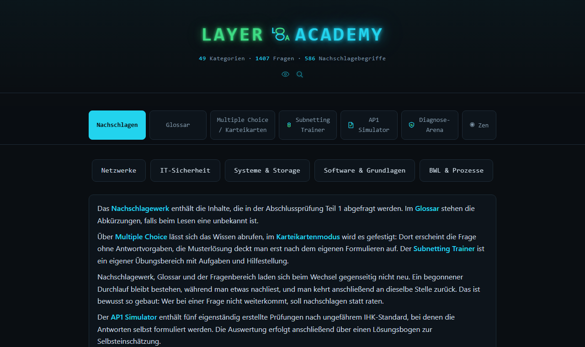

# Layer 8 Academy

Lernplattform für die IHK-Abschlussprüfung Teil 1 (AP1) der IT-Berufe, dazu Programmiergrundlagen bis zur AP2.
Kostenlos, ohne Anmeldung, ohne Tracking.

**Live:** https://layer8academy.boxberger.app/



## Funktionen

| Bereich | Inhalt |
|---|---|
| Nachschlagewerk | 48 Kapitel (Netzwerke, IT-Sicherheit, Systeme, Software, Wirtschaft), Volltextsuche |
| Fragen | 1407 Multiple-Choice-Fragen in 49 Kategorien, Karteikartenmodus, Wiederholung falscher Antworten, Karten zum Ausdrucken |
| Glossar | 586 Begriffe, Erklärung beim Darüberfahren im Text |
| AP1-Simulator | Übungsprüfungen mit Zeitlimit und Auswertung |
| Subnetting-Trainer | IPv4 und IPv6 |
| Code lesen | 11 Kurse, 103 Lektionen: Pseudocode, Softwareplanung, OOP/UML, SQL, Python, JavaScript, Java, C#, C, C++, Prüfungswissen AP2 |

Code lesen: Erklärung zu jeder Codezeile, Quiz, Übungen, Schritt-für-Schritt-Ausführung von Pseudocode, JavaScript und SQL laufen im Browser, Autovervollständigung in den Codefeldern, Erklärung von Schlüsselwörtern beim Darüberfahren.

## Technik

- HTML, CSS und JavaScript ohne Framework, kein Build-Schritt für die Seiten
- Hosting: Cloudflare Workers (Static Assets), Push auf `main` deployt
- Statische Einzelseiten und Sitemaps für Suchmaschinen, erzeugt mit Node-Skripten in `tools/`
- SQL über [sql.js](https://github.com/sql-js/sql.js) (WebAssembly, lokal eingebunden)
- Fortschritt nur im `localStorage` des Browsers, kein Server, keine Datenbank

## Aufbau

```
index.html, app.js, styles.css   Hauptseite: Nachschlagewerk, Fragen, Glossar
seiten.js, seiten.css            Kopf und Navigation der erzeugten Einzelseiten
nachschlagen/, themen/           erzeugte Kapitel- und Themenseiten
ap1-simulator/                   Übungsprüfungen
subnetting-trainer/              Subnetting-Trainer
code-lernen/
  js/core.js                     Inhaltsmodell, Textformat, Syntaxfärbung
  js/app.js                      Oberfläche, Routing, Quiz, Übungen
  js/pseudo.js                   Pseudocode-Interpreter mit Ablaufprotokoll
  js/uml.js                      SVG-Renderer für Klassen-, Sequenz-, Use-Case-, Aktivitätsdiagramme, Struktogramme
  js/editor.js                   Autovervollständigung
  js/sandbox.js, js/runner.js    JavaScript-Ausführung im Web Worker
  js/content/                    Kursinhalte, Begriffe, Kürzel
  kurs/                          erzeugte Seiten pro Kurs und Lektion
tools/                           Build- und Prüfskripte (werden nicht ausgeliefert)
_headers, _redirects             Sicherheits-Header, Weiterleitungen
```

## Lokal starten

```
python -m http.server 8000
```

Dann `http://localhost:8000/` öffnen. Ein Webserver ist nötig, weil Web Worker und WebAssembly nicht über `file://` laufen.

## Skripte

| Befehl | Zweck |
|---|---|
| `node tools/seiten-bauen.mjs` | Kapitel- und Themenseiten der Hauptseite und `sitemap.xml` erzeugen |
| `node tools/code-lernen/seiten-bauen.js` | Seiten pro Kurs und Lektion und `code-lernen/sitemap.xml` erzeugen |
| `node tools/code-lernen/check.js` | Inhalte prüfen: Musterlösungen ausführen, Quiz, Doppelte, Antwortlängen |
| `node tools/code-lernen/pseudo-test.js` | Tests des Pseudocode-Interpreters |
| `node tools/code-lernen/run-predict.js` | Vorhersage-Aufgaben mit echten Compilern prüfen (Python, JDK, .NET, gcc lokal nötig) |

Beide Seitenbauer kennen `--pruefen` und melden veraltete Seiten. Nach Änderungen an Inhalten zuerst `check.js`, dann den passenden Seitenbauer ausführen.

## Sicherheit

- Content Security Policy in `_headers`; Code lesen ohne Netzwerkzugriff (`connect-src 'none'`)
- JavaScript-Übungen laufen in einem Web Worker mit eigener CSP, `fetch`, `WebSocket`, `importScripts` und ähnliche sind vorher gesperrt, Abbruch nach 2,5 s
- Python, Java, C#, C und C++ werden nicht ausgeführt, dort gibt es Vorhersage-Aufgaben
- Keine Nutzerdaten auf einem Server

## Hinweis

Privates Lernprojekt, kein Angebot der IHK. Inhalte, Aufbau und Didaktik sind eigene Arbeit; programmiert mit KI-Unterstützung (Claude Code).
