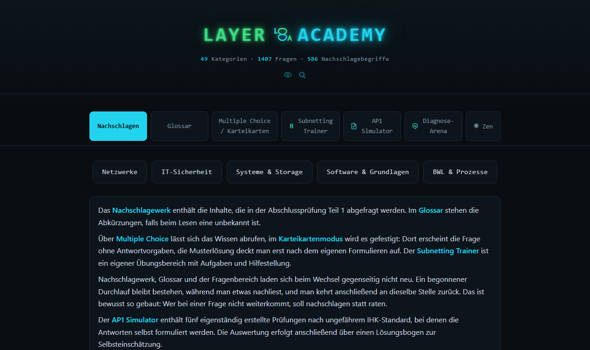

# Layer 8 Academy

Kostenlose, werbefreie Lernplattform für die **IHK-Abschlussprüfung Teil 1 (AP1)** der IT-Berufe.

**Live ansehen:** https://layer8academy.boxberger.app/



## Worum es geht

Die Layer 8 Academy ist während meiner Umschulung zum Fachinformatiker für Anwendungsentwicklung entstanden. Ursprünglich war sie nur für mich und ein paar Mitschüler gedacht, mit fünf Themen. Weil sie gut ankam, ist daraus ein vollständiges Nachschlagewerk mit Übungsbereich für die ganze AP1 geworden. Ich nutze sie selbst zum Lernen und erweitere sie mit jedem neuen Unterrichtsmodul.

## Was man damit machen kann

- **Nachlesen:** 48 Kapitel von Netzwerken über IT-Sicherheit bis Wirtschaft, mit Tabellen, Rechenbeispielen und typischen Prüfungsfallen
- **Üben:** 1407 Multiple-Choice-Fragen in 49 Kategorien, wahlweise als Karteikarten zum freien Antworten
- **Schwächen wiederholen:** falsch beantwortete Fragen werden gesammelt und lassen sich gezielt noch einmal üben
- **Prüfung simulieren:** fünf selbst erstellte Übungsprüfungen im Stil der AP1, dazu ein Subnetting-Trainer und ein Lernspiel zur Fehlersuche
- **Begriffe verstehen:** 586 Fachbegriffe im Glossar, die im Text beim Darüberfahren erklärt werden
- **Offline lernen:** Karteikarten zum Ausdrucken und Falten

Die Seite braucht keine Anmeldung, speichert keine Daten auf einem Server und enthält kein Tracking.

## Wie sie entstanden ist

Inhalte, Aufbau und Didaktik stammen von mir: Ich entscheide, was in ein Kapitel gehört, wie Fragen formuliert sind und woran man in der Prüfung typischerweise scheitert. Programmiert habe ich die Plattform mit KI-Unterstützung (Claude Code). Jede neue Frage und jedes Kapitel prüfe ich vor der Veröffentlichung.

Technisch ist die Seite bewusst schlicht gehalten: reines HTML, CSS und JavaScript ohne Frameworks, gehostet bei Cloudflare.

## Hinweis

Layer 8 Academy ist ein privates Lernprojekt und kein amtliches Angebot der IHK. Für verbindliche Auskünfte zur Prüfung: [IHK-Finder](https://www.dihk.de/ihk-finder).

---

<details>
<summary><strong>Technische Details für Entwickler</strong></summary>

### Aufbau

Reines HTML/CSS/JavaScript, keine Frameworks, kein Build-Schritt für die App selbst.

```
index.html   Struktur, Reader-Inhalte, Navigation
app.js       Fragenpools, Glossar, Quiz-Logik, Kartendruck, Bubble-Rendering
styles.css   Theming (mehrere Farbschemata über CSS-Variablen)
seiten.css   Zusatz-Styles für die erzeugten Einzelseiten
seiten.js    Kopf und Menüleiste der Einzelseiten (wie in der App)
tools/       seiten-bauen.mjs: erzeugt die Einzelseiten (siehe unten)
docs/        Vorschaubild für dieses README (wird nicht ausgeliefert)
```

Eigene Bereiche: Subnetting Trainer (`/subnetting-trainer/`), AP1 Simulator (`/ap1-simulator/`), Diagnose-Arena (`/osi-battle/`).

### Eigene Seiten für Suchmaschinen

Die Startseite bleibt die App (Sprünge, Suche, Quiz, Glossar-Bubbles). Zusätzlich lässt sich jedes Kapitel über Karten einzeln aufrufen, jeweils mit eigener Adresse, eigenem Titel und eigener Beschreibung für Suchmaschinen:

| Adresse | Inhalt |
|---|---|
| `/themen/<feld>/` | die 5 Themenfelder (Netzwerke, IT-Sicherheit …) mit den Karten ihrer Kapitel |
| `/nachschlagen/` | Karten „Wissenswertes zur AP1“ und „Gesamtes Nachschlagewerk“, darunter alle Themenfelder |
| `/nachschlagen/<kapitel>/` | ein Kapitel einzeln, darunter die Karten der anderen Kapitel des Themenfelds |

Kopf (Logo, Zahlen, Auge, Lupe), Menüleiste, Fußzeile und Pfeil nach oben sind dieselben wie in der App (`seiten.js` steuert sie). „Nachschlagen“ führt zur Startseite, „Glossar“ und „Multiple Choice“ in die Bereiche der App, die Lupe öffnet die Suche im gesamten Nachschlagewerk. Dafür versteht die App die Adressen `/#r-…`, `/#glossar`, `/#fragen`, `/#suche` und `/#impressum`.

Die Themenblasen und die Fußzeile der Startseite sind echte Links auf diese Seiten; `app.js` fängt sie in der App ab und verhält sich wie bisher (`data-r`, `data-ansicht`).

**Nach jeder Änderung an Kapiteln oder Themenfeldern:** `node tools/seiten-bauen.mjs` (schreibt Seiten, Sitemap, Themenblasen und Fußzeile). Prüfen ohne Schreiben: `node tools/seiten-bauen.mjs --pruefen`. Ein neues Kapitel braucht eine Adresse in `KAPITEL_SLUG` im Skript.

`.assetsignore` hält `.git`, `tools`, `docs` und Konfiguration aus der Auslieferung heraus.

### Kartendruck

Die Druckansicht öffnet sich in einem eigenen Fenster mit hellem Layout. Damit Schnitt- und Faltlinien passen, im Druckdialog Querformat, Skalierung 100 % bzw. „Tatsächliche Größe“ und Ränder „Keine“ wählen. Durchgezogene Linien werden geschnitten, gestrichelte gefaltet. Gedruckt werden nur Frage und richtige Antwort, ohne Erklärung. Fragen, die nur mit sichtbaren Antwortoptionen eindeutig sind (`card: false`), lassen sich nicht vormerken.

### Lokale Speicherung

| Schlüssel | Inhalt |
|---|---|
| `neint1_wrong_v1` | Wackelkandidaten Multiple Choice |
| `neint1_wrong_cards_v1` | Wackelkandidaten Karteikarten |
| `neint1_print_v1` | Auswahl für den Kartendruck |

Gespeichert wird jeweils der Fragetext. Wird eine Frage umformuliert, verliert ein gespeicherter Eintrag seinen Bezug.

### Deploy

Gehostet als Cloudflare Worker (Static Assets). Push auf `main` im Repo `boxalexe/neint1-lernplattform` deployed automatisch.

### Stand

48 Reader-Kapitel · 49 Kategorien · 1407 Fragen · 586 Glossarbegriffe

</details>
